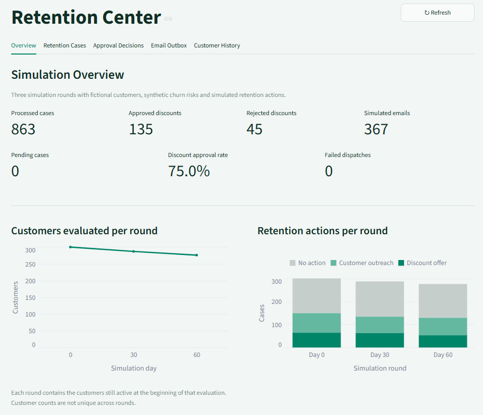

# Customer Retention Automation

An end-to-end customer retention automation demo using **Python, FastAPI, n8n, SQLite, and Streamlit**.

The project simulates customer churn risk over time, recommends retention actions, automates outreach workflows, routes discount offers through human approval, and visualizes the results in an interactive dashboard.

All customer records are synthetic. No real emails are sent, and no trained churn prediction model is required.

## Dashboard Preview



The dashboard provides an overview of retention activities across three simulation rounds, including 863 processed retention cases, discount approval outcomes, and simulated customer outreach.

Screenshots show a completed demonstration run using synthetic customer data and simulated retention actions.

## Features

- **Synthetic customer simulation:** Generate 300 reproducible customer records with baseline churn probabilities.
- **Recurring risk evaluations:** Evaluate customers at days 0, 30, and 60.
- **Simulated churn:** Track customer cancellations and exclude churned customers from future evaluations.
- **Retention decisions:** Assign `no_action`, `send_email`, or `offer_discount` based on simulated risk.
- **n8n automation:** Process retention cases and handle branching workflows.
- **Human approval:** Route discount proposals to an approval form before execution.
- **Email simulation:** Generate and record email jobs without contacting real customers.
- **Operational dashboard:** Explore customer risk, retention cases, decisions, and email history.
- **Persistent storage:** Store simulation results and automation state in SQLite.
- **Reproducible deployment:** Run the application using Docker Compose.

## Architecture

```text
Synthetic Customer Generator
            |
            v
      SQLite Database
            |
            v
   Churn Risk Simulation
     (Day 0 / 30 / 60)
            |
            v
         FastAPI
            |
      +-----+------+
      |            |
      v            v
     n8n        Streamlit
      |          Dashboard
      v
 Retention Actions
      |
      +-- no_action ------> Complete case
      |
      +-- send_email -----> Simulate email delivery
      |
      +-- offer_discount -> Human approval
                               |
                         +-----+-----+
                         |           |
                      Approved    Rejected
                         |           |
                   Simulate email   Record
                         |          rejection
                      Complete
```

The FastAPI application manages the simulation data and retention case lifecycle. n8n orchestrates the retention workflows, while Streamlit provides a read-only dashboard.

### n8n Workflow


The workflow processes evaluated customers, routes them to the appropriate retention action, and delegates discount proposals to a human-approval subworkflow.

## Technology Stack

| Component | Technology |
|---|---|
| Backend API | Python 3.12, FastAPI |
| Workflow automation | n8n 2.48.7 |
| Dashboard | Streamlit, pandas, Altair |
| Database | SQLite |
| Environment management | uv |
| Testing | pytest, Ruff |
| Deployment | Docker Compose |
| CI | GitHub Actions |

## Quick Start

### Prerequisites

- Docker and Docker Compose
- Git
- A web browser

Python and uv are only required for running scripts or tests directly on the host machine.

### 1. Clone the repository

```bash
git clone https://github.com/SL14-SL/customer-retention-automation.git
cd customer-retention-automation
```

### 2. Configure API authentication

The Docker Compose deployment uses API-key authentication to protect state-changing retention operations.

Generate a random API key:

```bash
docker run --rm python:3.12.9-slim \
  python -c "import secrets; print(secrets.token_urlsafe(32))"
```

Alternatively, if Python and uv are installed locally:

```bash
uv run python -c "import secrets; print(secrets.token_urlsafe(32))"
```

Create a `.env` file in the project root:

```dotenv
RETENTION_API_KEY=your-generated-secret
```

Replace `your-generated-secret` with the generated value.

The `.env` file is excluded from version control.

### 3. Start the application

Start the Docker Compose services:

```bash
docker compose up --build -d
```

Docker Compose starts the following services:

| Service | URL |
|---|---|
| FastAPI documentation | http://localhost:8001/docs |
| Streamlit dashboard | http://localhost:8504 |
| n8n | http://localhost:5679 |

An initialization service automatically creates 300 synthetic customers and generates three simulation rounds.

To inspect the services:

```bash
docker compose ps -a
```

The `init-demo` service should finish with exit code 0.

The API should report a healthy status.

### 4. Set up n8n

Open http://localhost:5679 and complete the initial n8n owner-account setup.

Once the account has been created, initialize the API credential and import both workflows:

```bash
bash scripts/setup_n8n.sh --provision-credential
```

The setup script:

1. Temporarily stops the n8n service.
2. Reads the API key from the local `.env` file.
3. Creates and imports the `Retention API` Header Auth credential.
4. Imports both workflow definitions from `n8n/workflows/`.
5. Restarts n8n.

The HTTP Request nodes automatically reference the imported credential.

The exported workflow IDs, subworkflow references, and credential IDs are aligned. No manual workflow or credential configuration is required after a successful fresh installation.

Open n8n and verify that the following workflows are available:

- `Customer Retention Automation`
- `Retention Approval`

The credential and workflows persist in the n8n Docker volume across container restarts.

**Note:** The import is intended for initial setup. Reimporting workflows or credentials may overwrite existing definitions or credentials with matching IDs.

For subsequent application starts, the normal command is sufficient:

```bash
docker compose up -d
```

There is no need to repeat the n8n import after every restart.

## Running the Demo

### 1. Select a simulation round

Open the `Customer Retention Automation` workflow in n8n.

In the `Simulation Config` node, select one of the available rounds:

| Round | Day | Active customers |
|---|---:|---:|
| `day-000` | 0 | 300 |
| `day-030` | 30 | 287 |
| `day-060` | 60 | 276 |

These counts are produced by the default deterministic simulation configuration.

### 2. Execute the retention workflow

Run the main n8n workflow.

The workflow retrieves evaluated customers from FastAPI and applies the corresponding retention action:

- **No action:** Create and complete the retention case without outreach.
- **Send email:** Create a case, generate an email job, and simulate delivery.
- **Offer discount:** Create a case and initiate the human-approval subworkflow.

Each customer can have a separate retention case for each simulation round.

### 3. Process discount approvals

Discount proposals are registered with a unique n8n approval execution.

You can review them manually through the approval forms or simulate decisions using the provided helper script.

First, install the local Python dependencies:

```bash
uv sync --locked
```

Preview the planned decisions:

```bash
uv run python scripts/simulate_retention_approvals.py \
  --round day-000
```

Submit the simulated decisions:

```bash
uv run python scripts/simulate_retention_approvals.py \
  --round day-000 \
  --apply
```

By default, decisions are generated deterministically with an approximate 70% approval rate.

To test one approval first:

```bash
uv run python scripts/simulate_retention_approvals.py \
  --round day-000 \
  --apply \
  --limit 1
```

The script submits decisions through the existing signed n8n approval forms and verifies the resulting case status through FastAPI.

Repeat the workflow execution and approval simulation for `day-030` and `day-060`.

#### Approval Monitoring


The dashboard tracks discount proposals, approval and rejection decisions, and individual case histories.

### 4. Review the dashboard

Open http://localhost:8504.

The dashboard contains five views:

| View | Description |
|---|---|
| Overview | Population, churn, retention actions, and approval results |
| Retention Cases | Searchable history of retention cases and statuses |
| Approval Decisions | Discount proposals, approvals, rejections, and pending decisions |
| Email Outbox | Simulated email jobs, statuses, and message previews |
| Customer History | Individual churn-risk evaluations and retention actions |

The dashboard reads data from FastAPI and updates as cases progress through the workflows.

#### Customer History


Individual customer histories show simulated churn-risk changes, evaluation results, and retention workflow actions across multiple rounds.

## API

Interactive API documentation is available at:

http://localhost:8001/docs

Example endpoints:

| Endpoint | Purpose |
|---|---|
| `GET /health` | Application health |
| `GET /retention/churn-simulation/overview` | Simulation summary |
| `GET /retention/churn-simulation/customers` | Evaluated customers |
| `GET /retention/churn-simulation/customers/{customer_id}` | Customer risk history |
| `GET /retention/churn-simulation/rounds/{round_id}/customers` | Evaluations for a specific round |
| `POST /retention/round-cases` | Create a retention case |
| `GET /retention/round-cases` | List retention cases |
| `GET /retention/round-email-jobs` | List simulated email jobs |

Additional endpoints manage discount approvals, decisions, email creation, simulated delivery, and dispatch failures.

Example:

```bash
curl http://localhost:8001/retention/churn-simulation/overview
```

## Local Development

Install the dependencies:

```bash
uv sync --locked --dev
```

Run formatting checks:

```bash
uv run ruff format --check src tests scripts retention_dashboard.py
```

Run linting:

```bash
uv run ruff check src tests scripts retention_dashboard.py
```

Run tests:

```bash
uv run pytest -q
```

Tests use isolated temporary SQLite databases and do not modify the running Docker demo.

## Isolated End-to-End Testing

A separate Docker Compose configuration allows testing a fresh installation without affecting the main demo.

Start an isolated environment:

```bash
docker compose -p retention-e2e-check \
  -f compose.yaml \
  -f compose.e2e.yaml \
  up -d --build
```

The isolated environment uses separate Docker volumes and ports:

| Service | URL |
|---|---|
| FastAPI | http://localhost:8002/docs |
| Streamlit | http://localhost:8505 |
| n8n | http://localhost:5680 |

After creating the n8n owner account, stop n8n and import the workflows:

```bash
docker compose -p retention-e2e-check \
  -f compose.yaml -f compose.e2e.yaml stop n8n

docker compose -p retention-e2e-check \
  -f compose.yaml -f compose.e2e.yaml \
  --profile setup run --rm --no-deps n8n-import

docker compose -p retention-e2e-check \
  -f compose.yaml -f compose.e2e.yaml start n8n
```

Open the imported workflows in n8n and execute the `day-000` simulation. Verify that discount approvals are processed and reflected in the Streamlit dashboard.

Remove only the isolated test environment:

```bash
docker compose -p retention-e2e-check \
  -f compose.yaml \
  -f compose.e2e.yaml \
  down -v
```

**Warning:** This removes the test environment's volumes and data. It does not remove the main demo's volumes.

## Data and Persistence

Two separate Docker volumes persist application data:

| Volume | Content |
|---|---|
| `retention_data` | Synthetic customers, churn simulation, retention cases, and simulated email jobs |
| `n8n_data` | n8n configuration, workflows, credentials, and execution history |

Normal container restarts preserve these volumes.

**Warning:** Running `docker compose down -v` permanently removes the volumes and their data for this Compose project, including the n8n configuration and execution history.

## Demo Scope and Assumptions

This project is a self-contained demonstration of an automated customer retention workflow.

The following design choices keep the demonstration reproducible and independent of external services:

- **Synthetic customer data:** The simulation uses 300 fictional customers and contains no real customer information.
- **Synthetic churn-risk scores:** Customer risk probabilities are generated for demonstration purposes rather than produced by a trained machine learning model.
- **Simulated customer cancellations:** Churn events are generated deterministically to demonstrate customer lifecycle changes across simulation rounds.
- **Simulated customer communication:** Email jobs are created and processed without contacting an external email provider.
- **Demonstration retention policies:** Retention actions and discount proposals follow predefined rules rather than experimentally validated intervention strategies.
- **Simulated approval decisions:** Human approval workflows can be demonstrated interactively or processed using reproducible simulated decisions.

These characteristics are intentional design choices rather than missing implementation features.

The simulation demonstrates workflow orchestration, state management, approval handling, and customer lifecycle tracking. It does not establish the predictive accuracy of a trained churn model or measure the causal impact of retention interventions.

## API Security

The application implements API-key authentication for state-changing retention operations.

When `RETENTION_API_KEY` is configured, all POST endpoints require a valid `X-API-Key` header.

| Request | Expected response |
|---|---|
| `GET /health` without authentication | HTTP 200 |
| POST request without an API key | HTTP 401 |
| POST request with an invalid API key | HTTP 401 |
| POST request with a valid API key | Processed normally |
| POST request with a valid API key and invalid payload | HTTP 422 |

The Docker Compose configuration requires an API key. For local development and automated testing, the application can also run without authentication when no key is configured.

### n8n integration

n8n authenticates its state-changing API requests using a shared Header Auth credential.

The credential is automatically provisioned during initial setup and referenced by both imported workflows.

The API key is read from the local `.env` file and is not included in the workflow JSON exports.

The complete configuration procedure is described in the [Quick Start](#quick-start).

## Production Considerations

The application demonstrates a complete local retention automation workflow, including API-key authentication, credential provisioning, and persistent state management.

A deployment involving real customer data would require additional infrastructure-specific considerations, such as:

- Authentication and authorization for accessing customer information.
- HTTPS and appropriate network access controls.
- Production database infrastructure, backups, and recovery procedures.
- Operational monitoring, audit logging, and security controls.
- Integration with actual customer management and communication systems.

The appropriate implementation depends on the target environment, organizational security requirements, and existing infrastructure.

## Related Project

This project focuses on the operational side of customer retention: transforming churn-risk scores into automated workflows, human approval decisions, and customer outreach.

For a complementary implementation of the machine learning lifecycle, see:

**[MLOps Churn Prediction](https://github.com/SL14-SL/mlops-churn-prediction)**

That project demonstrates model training, churn prediction, evaluation, deployment, monitoring, and model lifecycle management.

Together, the two projects illustrate complementary components of an ML-driven customer retention architecture:

- **MLOps Churn Prediction:** Producing, deploying, and monitoring churn predictions.
- **Customer Retention Automation:** Processing churn-risk scores and coordinating retention actions.

The projects are independent implementations and are not directly integrated.

## License

This project is licensed under the MIT License. See [LICENSE](LICENSE) for details.
