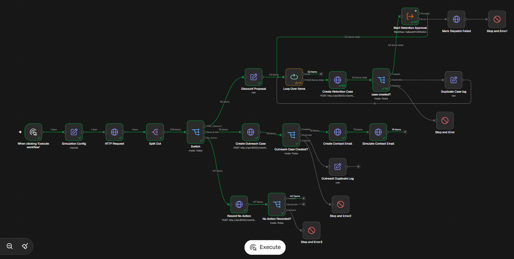
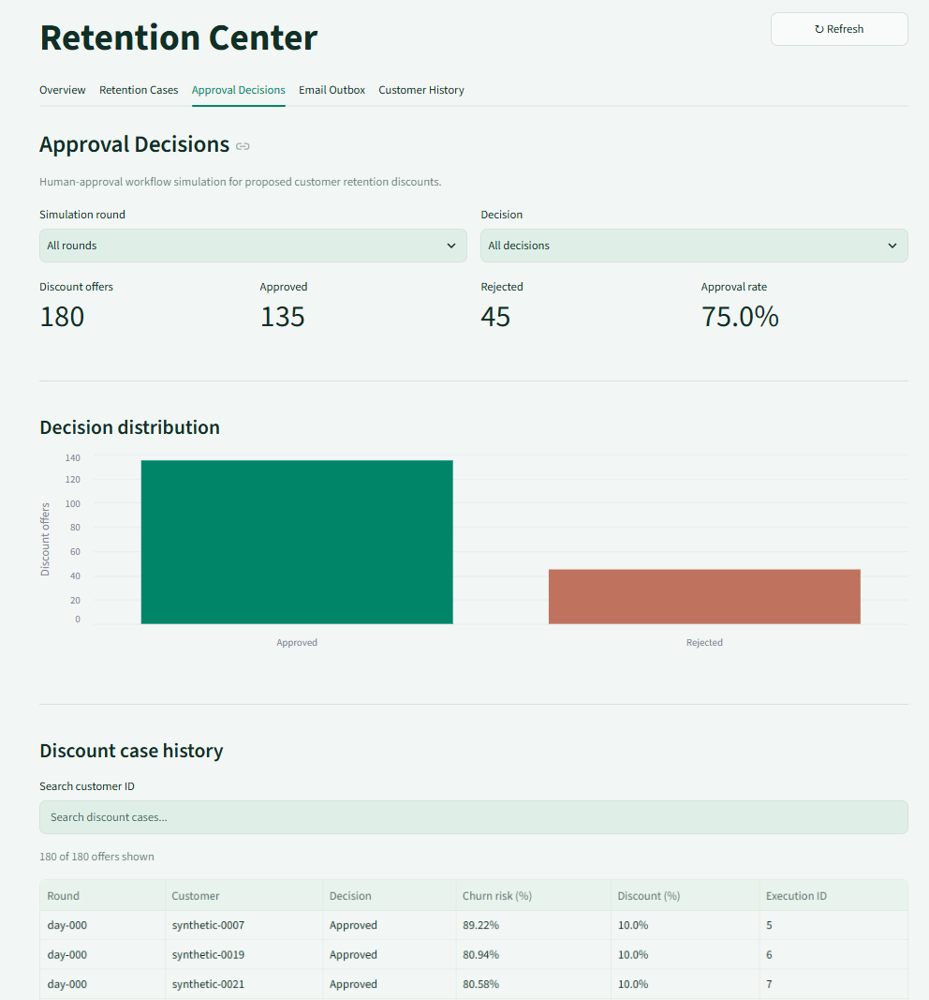
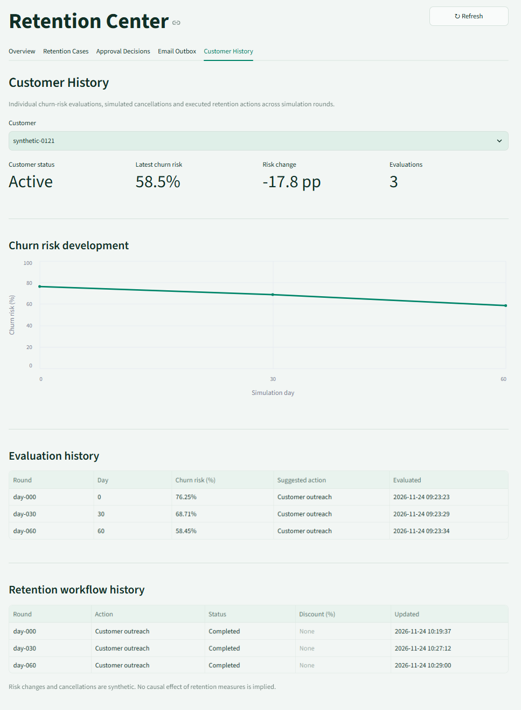

# Customer Retention Automation

An end-to-end customer retention automation demo using **Python, FastAPI, n8n, SQLite, and Streamlit**.

The project simulates customer churn risk over time, recommends retention actions, automates outreach workflows, routes discount offers through human approval, and visualizes the results in an interactive dashboard.

All customer records are synthetic. No real emails are sent, and no trained churn prediction model is required.

## Dashboard Preview


The dashboard provides an overview of retention activities across three simulation rounds, including 863 processed retention cases, discount approval outcomes, and simulated customer outreach.

Screenshots show a completed demonstration run using synthetic customer data and simulated retention actions.

## Features

- **Synthetic customer simulation:** Generate 300 reproducible customer records with baseline churn probabilities.
- **Recurring risk evaluations:** Evaluate customers at days 0, 30, and 60.
- **Simulated churn:** Track customer cancellations and exclude churned customers from future evaluations.
- **Retention decisions:** Assign `no_action`, `send_email`, or `offer_discount` based on simulated risk.
- **n8n automation:** Process retention cases and handle branching workflows.
- **Human approval:** Route discount proposals to an approval form before execution.
- **Email simulation:** Generate and record email jobs without contacting real customers.
- **Operational dashboard:** Explore customer risk, retention cases, decisions, and email history.
- **Persistent storage:** Store simulation results and automation state in SQLite.
- **Reproducible deployment:** Run the application using Docker Compose.

## Architecture

```text
Synthetic Customer Generator
            |
            v
      SQLite Database
            |
            v
   Churn Risk Simulation
     (Day 0 / 30 / 60)
            |
            v
         FastAPI
            |
      +-----+------+
      |            |
      v            v
     n8n        Streamlit
      |          Dashboard
      v
 Retention Actions
      |
      +-- no_action ------> Complete case
      |
      +-- send_email -----> Simulate email delivery
      |
      +-- offer_discount -> Human approval
                               |
                         +-----+-----+
                         |           |
                      Approved    Rejected
                         |           |
                   Simulate email   Record
                         |          rejection
                      Complete
```

The FastAPI application manages the simulation data and retention case lifecycle. n8n orchestrates the retention workflows, while Streamlit provides a read-only dashboard.

### n8n Workflow



The workflow processes evaluated customers, routes them to the appropriate retention action, and delegates discount proposals to a human-approval subworkflow.

## Technology Stack

| Component | Technology |
|---|---|
| Backend API | Python 3.12, FastAPI |
| Workflow automation | n8n 2.48.7 |
| Dashboard | Streamlit, pandas, Altair |
| Database | SQLite |
| Environment management | uv |
| Testing | pytest, Ruff |
| Deployment | Docker Compose |
| CI | GitHub Actions |

## Quick Start

### Prerequisites

- Docker and Docker Compose
- Git
- A web browser

Python and uv are only required for running scripts or tests directly on the host machine.

### 1. Clone the repository

```bash
git clone https://github.com/SL14-SL/customer-retention-automation.git
cd customer-retention-automation
```

### 2. Start the application

```bash
docker compose up --build -d
```

Docker Compose starts the following services:

| Service | URL |
|---|---|
| FastAPI documentation | http://localhost:8001/docs |
| Streamlit dashboard | http://localhost:8504 |
| n8n | http://localhost:5679 |

An initialization service automatically creates 300 synthetic customers and generates three simulation rounds.

To inspect the services:

```bash
docker compose ps -a
```

The `init-demo` service should finish with exit code 0.

### 3. Set up n8n

Open http://localhost:5679 and complete the initial n8n owner-account setup.

Once the account has been created, import the workflows using:

```bash
./scripts/setup_n8n.sh
```

The script:

1. Stops the n8n service temporarily.
2. Imports the two workflow JSON files from `n8n/workflows/`.
3. Restarts n8n.

The exported workflow IDs and subworkflow references are aligned, so no manual workflow-ID editing should be necessary.

Open n8n and verify that the following workflows are available:

- `Customer Retention Automation`
- `Retention Approval`

The workflow import is a one-time setup step. Existing workflows persist in the n8n Docker volume across restarts.

Do not rerun the import script unnecessarily on an installation where workflows have been edited, because importing can replace existing workflow definitions.

## Running the Demo

### 1. Select a simulation round

Open the `Customer Retention Automation` workflow in n8n.

In the `Simulation Config` node, select one of the available rounds:

| Round | Day | Active customers |
|---|---:|---:|
| `day-000` | 0 | 300 |
| `day-030` | 30 | 287 |
| `day-060` | 60 | 276 |

These counts are produced by the default deterministic simulation configuration.

### 2. Execute the retention workflow

Run the main n8n workflow.

The workflow retrieves evaluated customers from FastAPI and applies the corresponding retention action:

- **No action:** Create and complete the retention case without outreach.
- **Send email:** Create a case, generate an email job, and simulate delivery.
- **Offer discount:** Create a case and initiate the human-approval subworkflow.

Each customer can have a separate retention case for each simulation round.

### 3. Process discount approvals

Discount proposals are registered with a unique n8n approval execution.

You can review them manually through the approval forms or simulate decisions using the provided helper script.

First, install the local Python dependencies:

```bash
uv sync --locked
```

Preview the planned decisions:

```bash
uv run python scripts/simulate_retention_approvals.py \
  --round day-000
```

Submit the simulated decisions:

```bash
uv run python scripts/simulate_retention_approvals.py \
  --round day-000 \
  --apply
```

By default, decisions are generated deterministically with an approximate 70% approval rate.

To test one approval first:

```bash
uv run python scripts/simulate_retention_approvals.py \
  --round day-000 \
  --apply \
  --limit 1
```

The script submits decisions through the existing signed n8n approval forms and verifies the resulting case status through FastAPI.

Repeat the workflow execution and approval simulation for `day-030` and `day-060`.

### Approval Monitoring



The dashboard tracks discount proposals, approval and rejection decisions, and individual case histories.

### 4. Review the dashboard

Open http://localhost:8504.

The dashboard contains five views:

| View | Description |
|---|---|
| Overview | Population, churn, retention actions, and approval results |
| Retention Cases | Searchable history of retention cases and statuses |
| Approval Decisions | Discount proposals, approvals, rejections, and pending decisions |
| Email Outbox | Simulated email jobs, statuses, and message previews |
| Customer History | Individual churn-risk evaluations and retention actions |

The dashboard reads data from FastAPI and updates as cases progress through the workflows.

### Customer History



Individual customer histories show simulated churn-risk changes, evaluation results, and retention workflow actions across multiple rounds.

## API

Interactive API documentation is available at:

http://localhost:8001/docs

Example endpoints:

| Endpoint | Purpose |
|---|---|
| `GET /health` | Application health |
| `GET /retention/churn-simulation/overview` | Simulation summary |
| `GET /retention/churn-simulation/customers` | Evaluated customers |
| `GET /retention/churn-simulation/customers/{customer_id}` | Customer risk history |
| `GET /retention/churn-simulation/rounds/{round_id}/customers` | Evaluations for a specific round |
| `POST /retention/round-cases` | Create a retention case |
| `GET /retention/round-cases` | List retention cases |
| `GET /retention/round-email-jobs` | List simulated email jobs |

Additional endpoints manage discount approvals, decisions, email creation, simulated delivery, and dispatch failures.

Example:

```bash
curl http://localhost:8001/retention/churn-simulation/overview
```

## Local Development

Install the dependencies:

```bash
uv sync --locked --dev
```

Run formatting checks:

```bash
uv run ruff format --check src tests scripts retention_dashboard.py
```

Run linting:

```bash
uv run ruff check src tests scripts retention_dashboard.py
```

Run tests:

```bash
uv run pytest -q
```

Tests use isolated temporary SQLite databases and do not modify the running Docker demo.

## Data and Persistence

Two separate Docker volumes persist application data:

| Volume | Content |
|---|---|
| `retention_data` | Synthetic customers, churn simulation, retention cases, and simulated email jobs |
| `n8n_data` | n8n configuration, workflows, credentials, and execution history |

Normal container restarts preserve these volumes.

**Warning:** Running `docker compose down -v` permanently removes the volumes and their data for this Compose project, including the n8n configuration and execution history.

## Limitations

This project is a portfolio demonstration, not a production customer retention platform.

- All customer data is synthetic.
- Churn probabilities are simulated rather than predicted by a trained ML model.
- Retention policies are demonstration rules, not experimentally validated interventions.
- Email delivery is simulated; no external email provider is contacted.
- Approval decisions may be simulated for demonstration purposes.
- The application does not measure real customer retention uplift or causal effects.
- Authentication, authorization, secrets management, and production deployment hardening would be required before using the architecture with real customer data.

## License

This project is licensed under the MIT License. See [LICENSE](LICENSE) for details.
